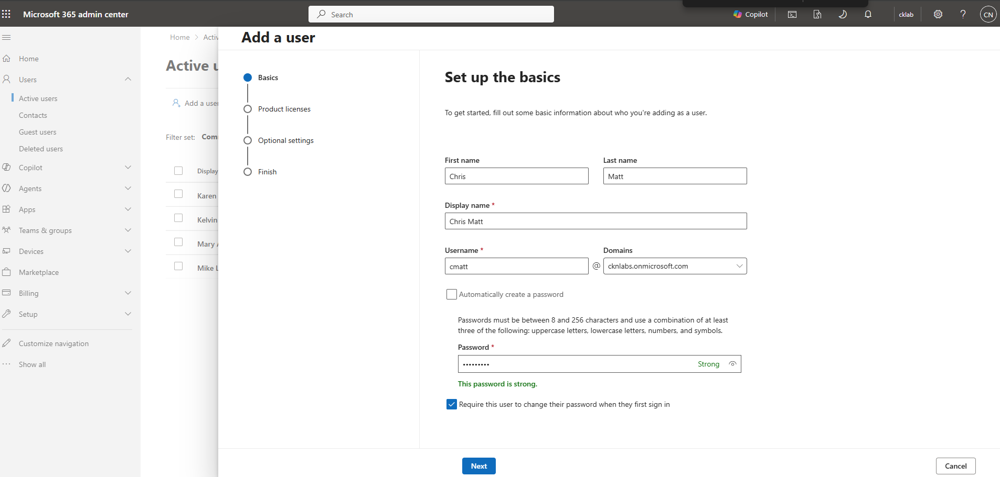
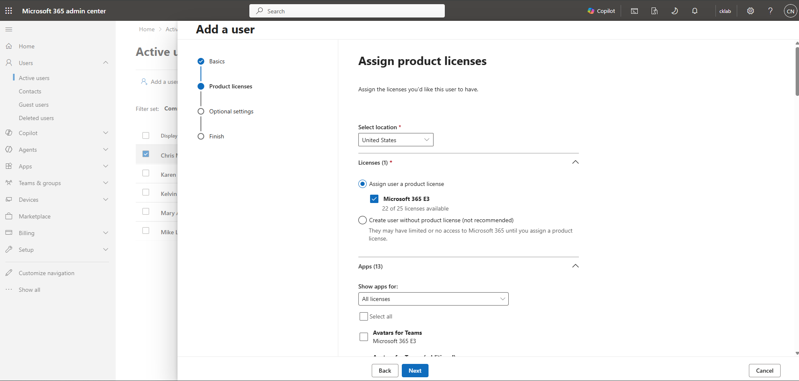
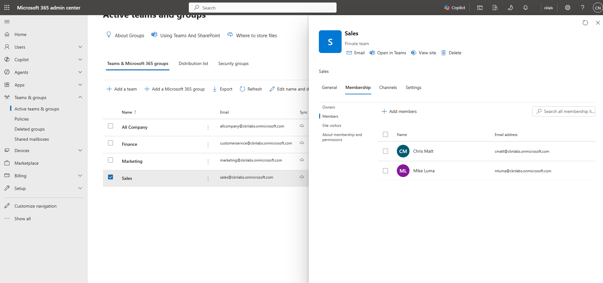
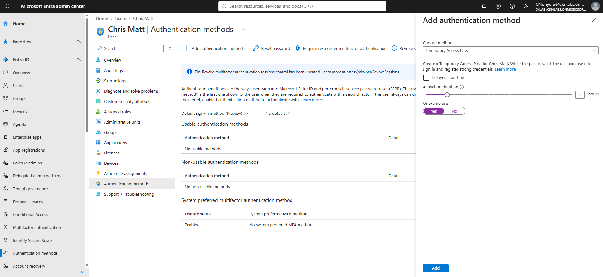
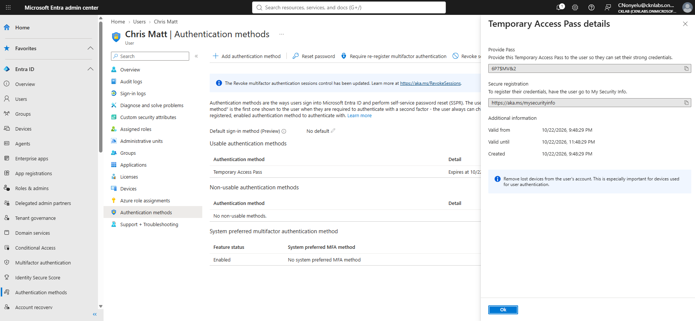

# Microsoft 365 Administration Labs

This repository documents my Microsoft 365 administration lab projects. The goal of this portfolio is to simulate real-world IT support and Microsoft 365 administrator tasks, including user onboarding, identity management, security, compliance, and access control.

Tools and Services Used
- Microsoft 365 Admin Center
- Microsoft Entra Admin Center
- Microsoft 365 user management
- License assignment
- Multi-Factor Authentication (MFA)

> Note: This is a simulated lab project created for portfolio purposes no real company account was used for the project.
---

## Table of Contents

1. [Tenant Details](#tenant-details)
2. [New User Onboarding in Microsoft 365](#New-User-Onboarding-in-Microsoft-365) 

# Tenant Details

| Component | Details |
|-----------|---------|
| Plan | Microsoft 365 Business Premium |
| Tenant | cknlabs.onmicrosoft.com |
| Users/Groups | 5+ test users across IT, Finance, HR, Sales, Marketing |
| Admin Account | CNonyelu@cknlabs.onmicrosoft.com |
| Entra ID | included in Business Premium |
| Intune | Included in Business Premium |
| Defender | Defender for Business + Defender for Office 365 Plan 1 |
| Hardware | Dell Optiplex Core i7, 8GB RAM |

---
# New User Onboarding in Microsoft 365

## Scenario
A small business has hired a new employee who needs access to Microsoft 365 services such as Outlook, Teams, and OneDrive.

As the IT Specialist, I need to prepare the account and make sure the user can securely access the required services on their first day.

## Objectives
- Create a new user account in Microsoft 365
- Assign the appropriate license
- Add the user to the correct group
- Configure authentication readiness for secure account access
- Understand the user onboarding workflow

## Workflow
### Step 1: Create the New User Account
- Open Microsoft 365 Admin Center
- Go to Users > Active users
- Select **Add a user**
- Enter the employee's name, display name, and username
- Set an initial password and require password change at first sign-in
- Configure optional profile details such as job title, department, and location

### Step 2: Assign a Microsoft 365 License
- Assign a Microsoft 365 license to the new user
- Confirm access to core productivity and collaboration services, including Microsoft Teams, Outlook, and Microsoft 365 apps
- Review the included services, and the new user info
- Click Finish adding

> Note: In a production environment, license services should be reviewed and adjusted according to the user’s job role and business requirements.

### Step 3: Add the User to the Appropriate Group
- In the Microsoft 365 Admin Center, go to **Teams & groups** > **Active teams & groups**
- Select the appropriate group for the employee, such as **Sales**
- Open the group membership settings and add the new user
- Verify that the user is now a member of the selected group

This step helps assign collaboration access and organize users based on their department or role.

### Step 4: Review Authentication Settings
- In the Microsoft Entra admin center, opened the new user account
- Navigate to **Authentication methods**
- Review the user’s current authentication status and confirmed that no methods were registered yet
- Add **Temporary Access Pass (TAP)** as a temporary sign-in method (choose from Email, Phone Number, Temporary Access Pass, or QR code)
- Confirm that TAP can be used by the new user during first sign-in to begin secure account setup

This step supports secure onboarding by providing a temporary authentication method before the user registers stronger authentication methods.

> Note: Temporary Access Pass is useful during onboarding because it allows a new user to sign in and register additional authentication methods securely.

Some projects are conceptual and workflow-based to reflect practical IT administration scenarios.

## Author
**Chinonso Kelvin Nonyelu**

